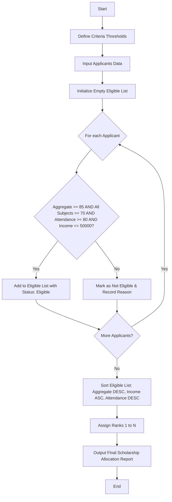

Here is a complete system design, algorithm, Mermaid flowchart, and Python implementation for the **University Scholarship Allocation System**.

---

## 1. Problem Statement

Design an automated scholarship allocation system for a university that filters, evaluates, and ranks applicants based on academic and socioeconomic criteria.

**Eligibility Criteria:**

* **Aggregate Marks:** $\ge 85.0\%$
* **Subject-wise Minimum Scores:** $\ge 70$ in all core subjects
* **Attendance:** $\ge 80.0\%$
* **Annual Family Income:** $\le \$50,000$

**Ranking & Tie-Breaker Rules:**

1. **Primary Key:** Higher aggregate marks (Descending order).
2. **Secondary Key (Tie-Breaker 1):** Lower annual family income (Ascending order).
3. **Tertiary Key (Tie-Breaker 2):** Higher attendance percentage (Descending order).

---

## 2. Algorithm

1. **Initialize:** Define threshold constants for aggregate marks, subject minimums, attendance, and maximum income.
2. **Input Data:** Collect applicant details including name, aggregate marks, dictionary of subject scores, attendance percentage, and annual income.
3. **Filter Applicants:**
* Iterate through each applicant.
* Check if aggregate marks $\ge$ required aggregate.
* Check if all subject scores $\ge$ subject-wise minimum.
* Check if attendance $\ge$ required attendance.
* Check if income $\le$ maximum income limit.
* If all conditions are met, mark the applicant as **Eligible** and add them to the eligible pool.


4. **Sort and Rank:**
* Sort the eligible pool using a multi-key sorting strategy:
* `-aggregate_marks` (Descending)
* `annual_income` (Ascending)
* `-attendance` (Descending)


* Assign sequential ranks (1, 2, 3...) to the sorted list.


5. **Output Results:** Display the ranked list of scholarship recipients alongside rejected applicants and reasons for rejection.

---

## 3. Flowchart



---


## 5. Sample Input

A list of applicant records containing academic and demographic details:

```python
[
    {"name": "Alice Smith", "aggregate": 91.5, "subjects": {"Math": 85, "Physics": 88, "Chemistry": 90}, "attendance": 92.0, "income": 42000},
    {"name": "Bob Jones", "aggregate": 88.0, "subjects": {"Math": 72, "Physics": 75, "Chemistry": 80}, "attendance": 85.0, "income": 35000},
    {"name": "Charlie Brown", "aggregate": 91.5, "subjects": {"Math": 90, "Physics": 92, "Chemistry": 89}, "attendance": 95.0, "income": 38000}, 
    {"name": "Diana Prince", "aggregate": 84.0, "subjects": {"Math": 80, "Physics": 85, "Chemistry": 82}, "attendance": 90.0, "income": 25000}, 
    {"name": "Evan Wright", "aggregate": 89.0, "subjects": {"Math": 65, "Physics": 80, "Chemistry": 85}, "attendance": 88.0, "income": 40000}, 
    {"name": "Fiona Gallagher", "aggregate": 93.0, "subjects": {"Math": 95, "Physics": 94, "Chemistry": 96}, "attendance": 96.0, "income": 48000}
]

```

---

## 6. Sample Output

```text
=== SCHOLARSHIP ALLOCATION RESULTS ===

[ELIGIBLE & RANKED STUDENTS (4)]
Rank  Name           Aggregate   Income    Attendance
-------------------------------------------------------
1     Fiona Gallagher 93.0        $48000    96.0%
2     Charlie Brown   91.5        $38000    95.0%
3     Alice Smith     91.5        $42000    92.0%
4     Bob Jones       88.0        $35000    85.0%

[REJECTED APPLICANTS (2)]
Name            Reason for Rejection
-------------------------------------------------------
Diana Prince    Aggregate 84.0% below 85.0%
Evan Wright     Subject score below 70 in: Math

```

---

Would you like to extend this system to include category-based seat reservations (e.g., SC/ST/OBC quotas)?
