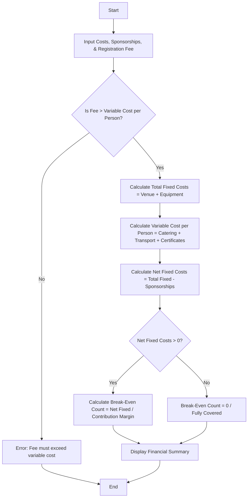

Here is a complete package for the **Campus Event Financial Planning** system, including the problem statement, algorithm, Mermaid flowchart, Python source code, sample inputs, and sample outputs.

---

## 1. Problem Statement

Design an automated financial planning and break-even analysis tool for campus event organizers. The system must process fixed costs (venue rental and equipment) and variable per-participant costs (catering, transport, and certificates). It must incorporate sponsorship funds, compute the net fixed costs, and calculate the **minimum participant registration count needed to break even** given a specified registration fee.

---

## 2. Algorithm

1. **Start** and input event parameters: Venue Cost, Equipment Cost, Catering Cost per person, Transport Cost per person, Certificate Cost per person, Total Sponsorship Amount, and Registration Fee per participant.
2. **Validate Inputs:** Ensure all monetary values are non-negative. Verify that the **Registration Fee** exceeds the **Variable Cost per person** (otherwise, break-even is mathematically impossible).
3. **Calculate Fixed Costs:**

$$\text{Total Fixed Costs} = \text{Venue Cost} + \text{Equipment Cost}$$


4. **Calculate Variable Costs per Person:**

$$\text{Variable Cost per Person} = \text{Catering} + \text{Transport} + \text{Certificates}$$


5. **Calculate Net Fixed Costs:**

$$\text{Net Fixed Costs} = \text{Total Fixed Costs} - \text{Sponsorships}$$


6. **Calculate Break-Even Participant Count:**
* If $\text{Net Fixed Costs} \le 0$, $\text{Break-Even Count} = 0$ (fully covered by sponsorships).
* Otherwise:

$$\text{Contribution Margin} = \text{Registration Fee} - \text{Variable Cost per Person}$$


$$\text{Break-Even Count} = \left\lceil \frac{\text{Net Fixed Costs}}{\text{Contribution Margin}} \right\rceil$$


7. **Display** the itemized cost breakdown and break-even analysis report.
8. **End**

---

## 3. Flowchart (Mermaid Code)



---


## 5. Sample Input

```python
venue = 1200.00
equipment = 450.00
catering_pp = 12.50
transport_pp = 5.00
certificate_pp = 2.50
sponsorships = 500.00
registration_fee = 35.00

```

---

## 6. Sample Output

```text
========================================
    CAMPUS EVENT FINANCIAL PLANNING     
========================================
Total Fixed Costs               : $1,650.00
Total Sponsorships              : $500.00
Net Fixed Costs                 : $1,150.00
Variable Cost Per Person        : $20.00
Registration Fee Per Person     : $35.00
Contribution Margin Per Person  : $15.00
Minimum Break-Even Count        : 77
Planning Status                 : Break-even target established.
========================================

```
