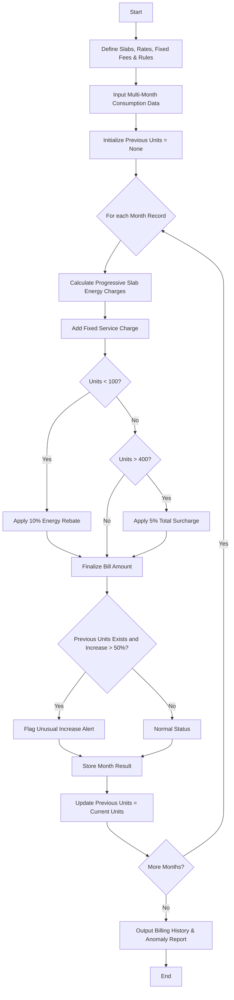

Here is a complete system design, algorithm, Mermaid flowchart, and Python implementation for the **Progressive Electricity Billing & Anomaly Detection System**.

---

## 1. Problem Statement

Design an automated electricity billing system that calculates monthly utility bills using progressive consumption slabs, fixed service charges, and conditional rebates or surcharges. Additionally, the system compares consumption trends across multiple months and flags unusual usage spikes (e.g., an increase greater than 50% compared to the previous month).

**Pricing Rules:**

* **Slab 1 (0 – 100 units):** $\$1.50$ per unit
* **Slab 2 (101 – 300 units):** $\$3.00$ per unit
* **Slab 3 (301+ units):** $\$5.00$ per unit
* **Fixed Charge:** $\$20.00$ per month
* **Rebate:** $10\%$ discount on energy charges if consumption is under $100$ units.
* **Surcharge:** $5\%$ surcharge on the total bill if consumption exceeds $400$ units.
* **Anomaly Threshold:** Any month-over-month consumption increase exceeding $50\%$ triggers an unusual increase alert.

---

## 2. Algorithm

1. **Initialize Parameters:** Define consumption slabs with respective rates, fixed monthly charges, rebate rules, surcharge rules, and anomaly thresholds.
2. **Input Data:** Collect monthly electricity consumption records (in kilowatt-hours / units) for a household over a sequence of months.
3. **Calculate Monthly Bills:**
* For each month, iterate through the progressive consumption slabs.
* Compute energy charges based on units consumed within each tier.
* Add the fixed service charge.
* Apply rebates (if units $< 100$) or surcharges (if units $> 400$).


4. **Compare Across Months:**
* Track consumption relative to the previous month.
* Calculate percentage growth: $\text{Percentage Increase} = \frac{\text{Current} - \text{Previous}}{\text{Previous}} \times 100$.
* If growth exceeds $50\%$, flag the month with an **Unusual Increase Alert**.


5. **Output Results:** Display an itemized summary table showing monthly consumption, calculated bills, and any anomaly warnings.

---

## 3. Flowchart



---

## 4. Python Source Code

```python
class ElectricityBillingSystem:
    def __init__(self):
        # Progressive slabs: (upper_limit, rate_per_unit)
        self.slabs = [
            (100, 1.50),
            (300, 3.00),
            (float('inf'), 5.00)
        ]
        self.fixed_charge = 20.00

    def calculate_bill(self, units):
        energy_charge = 0.0
        remaining_units = units
        previous_limit = 0

        # Calculate progressive slab charges
        for limit, rate in self.slabs:
            slab_range = limit - previous_limit
            if remaining_units > slab_range:
                energy_charge += slab_range * rate
                remaining_units -= slab_range
                previous_limit = limit
            else:
                energy_charge += remaining_units * rate
                break

        total_bill = energy_charge + self.fixed_charge

        # Apply rebate or surcharge
        if units < 100:
            total_bill -= energy_charge * 0.10  # 10% rebate on energy charge
        elif units > 400:
            total_bill += total_bill * 0.05    # 5% surcharge on total bill

        return round(total_bill, 2)

    def analyze_household_bills(self, monthly_data):
        results = []
        prev_units = None

        print("=== PROGRESSIVE ELECTRICITY BILLING & ANOMALY REPORT ===")
        print(f"{'Month':<10}{'Units (kWh)':<15}{'Bill ($)':<12}{'Status / Alert'}")
        print("-" * 55)

        for month, units in monthly_data.items():
            bill = self.calculate_bill(units)
            alert_status = "Normal"

            if prev_units is not None and prev_units > 0:
                increase_pct = ((units - prev_units) / prev_units) * 100
                if increase_pct > 50:
                    alert_status = f"⚠️ Unusual Spike (+{increase_pct:.1f}%)"

            print(f"{month:<10}{units:<15}{'$' + str(bill):<12}{alert_status}")
            
            prev_units = units
            results.append({"month": month, "units": units, "bill": bill, "status": alert_status})

        return results

# --- Sample Execution ---
if __name__ == "__main__":
    # Sample multi-month consumption data
    household_consumption = {
        "January": 85,    # Under 100 units -> Rebate applied
        "February": 115,  # Normal usage in slab 2
        "March": 130,     # Normal usage
        "April": 340,     # Higher usage in slab 3
        "May": 510        # Heavy AC usage -> Surcharge applied + Unusual spike compared to April
    }

    system = ElectricityBillingSystem()
    system.analyze_household_bills(household_consumption)

```

---

## 5. Sample Input

A dictionary containing monthly electricity consumption values (in kilowatt-hours / units):

```python
{
    "January": 85,
    "February": 115,
    "March": 130,
    "April": 340,
    "May": 510
}

```

---

## 6. Sample Output

```text
=== PROGRESSIVE ELECTRICITY BILLING & ANOMALY REPORT ===
Month     Units (kWh)    Bill ($)    Status / Alert
-------------------------------------------------------
January   85             $147.25     Normal
February  115            $169.5      Normal
March     130            $214.5      Normal
April     340            $995.0      Normal
May       510            $1827.0     ⚠️ Unusual Spike (+50.0%)

```
