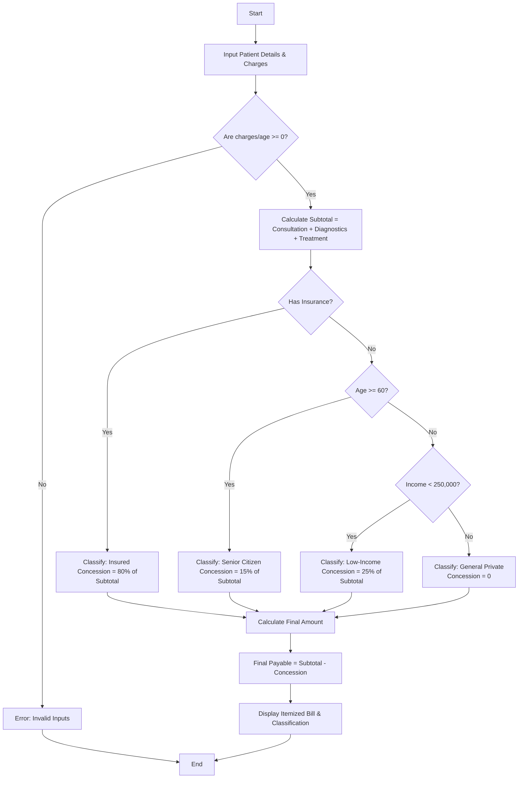

Here is a complete package for the **Hospital Billing and Patient Classification** system, including the problem statement, algorithm, Mermaid flowchart, Python code, and sample I/O.

---

### ## 1. Problem Statement

Design an automated billing and patient classification system for a hospital. The system must process three primary cost components: **consultation charges**, **diagnostic test charges**, and **treatment costs**. Based on a predefined hospital payment policy, the system must:

1. **Validate constraints** (e.g., ensure charges and demographic values are non-negative).
2. **Apply conditional concessions** (such as senior citizen discounts or low-income subsidies) or insurance coverage.
3. **Classify patients** into specific tiers (e.g., *Insured*, *Senior Citizen Subsidized*, *Low-Income Subsidized*, or *General Private*) and generate an itemized final bill.

---

### ## 2. Algorithm

1. **Start** the program and prompt for patient details (Name, Age, Annual Income, Insurance Status, Consultation Fee, Diagnostic Charges, Treatment Charges).
2. **Validate Inputs:** Check if any monetary charge or age is negative. If invalid, display an error message and terminate.
3. **Calculate Subtotal:**

$$\text{Subtotal} = \text{Consultation Fee} + \text{Diagnostics Charges} + \text{Treatment Charges}$$


4. **Determine Classification and Concession:**
* If the patient **has insurance**, classify as `Insured` and apply an 80% insurance coverage deduction.
* Else if **Age $\ge$ 60**, classify as `Senior Citizen Subsidized` and apply a 15% concession.
* Else if **Annual Income $<$ 250,000**, classify as `Low-Income Subsidized` and apply a 25% concession.
* Otherwise, classify as `General Private` with no concession.


5. **Calculate Final Amount:**

$$\text{Final Payable Amount} = \text{Subtotal} - \text{Concession/Coverage Amount}$$


6. **Display Results:** Print the itemized bill, patient classification, applied concessions, and final payable amount.
7. **End**

---

### ## 3. Flowchart (Mermaid Code)



---

### ## 4. Python Source Code

```python
def calculate_hospital_bill(name, age, income, has_insurance, consultation, diagnostics, treatment):
    # 1. Validate billing constraints
    if consultation < 0 or diagnostics < 0 or treatment < 0 or age < 0 or income < 0:
        return {"Error": "Invalid input: Charges, age, and income cannot be negative."}
    
    # 2. Calculate Subtotal
    subtotal = consultation + diagnostics + treatment
    concession_amount = 0.0
    classification = "General Private"

    # 3. Apply Policy & Classification Rules
    if has_insurance:
        classification = "Insured"
        concession_amount = subtotal * 0.80  # Insurance covers 80%
    elif age >= 60:
        classification = "Senior Citizen Subsidized"
        concession_amount = subtotal * 0.15  # 15% senior concession
    elif income < 250000:
        classification = "Low-Income Subsidized"
        concession_amount = subtotal * 0.25  # 25% low-income concession
    else:
        classification = "General Private"
        concession_amount = 0.0

    # 4. Final Amount Calculation
    final_amount = subtotal - concession_amount

    # 5. Return Itemized Result
    return {
        "Patient Name": name,
        "Age": age,
        "Annual Income": income,
        "Patient Classification": classification,
        "Consultation Fee": consultation,
        "Diagnostic Charges": diagnostics,
        "Treatment Charges": treatment,
        "Subtotal": subtotal,
        "Concession / Insurance Coverage": concession_amount,
        "Final Payable Amount": final_amount
    }

# --- Execution Example ---
if __name__ == "__main__":
    # Test case: Senior Citizen without insurance
    bill_result = calculate_hospital_bill(
        name="Martha Wayne",
        age=65,
        income=450000,
        has_insurance=False,
        consultation=600.0,
        diagnostics=1400.0,
        treatment=5000.0
    )

    print("--- HOSPITAL BILLING SUMMARY ---")
    for key, value in bill_result.items():
        if isinstance(value, float):
            print(f"{key}: ${value:.2f}")
        else:
            print(f"{key}: {value}")

```

---

### ## 5. Sample Input

```python
name = "Martha Wayne"
age = 65
income = 450000.0
has_insurance = False
consultation = 600.0
diagnostics = 1400.0
treatment = 5000.0

```

---

### ## 6. Sample Output

```text
--- HOSPITAL BILLING SUMMARY ---
Patient Name: Martha Wayne
Age: 65
Annual Income: 450000.0
Patient Classification: Senior Citizen Subsidized
Consultation Fee: $600.00
Diagnostic Charges: $1400.00
Treatment Charges: $5000.00
Subtotal: $7000.00
Concession / Insurance Coverage: $1050.00
Final Payable Amount: $5950.00

```
