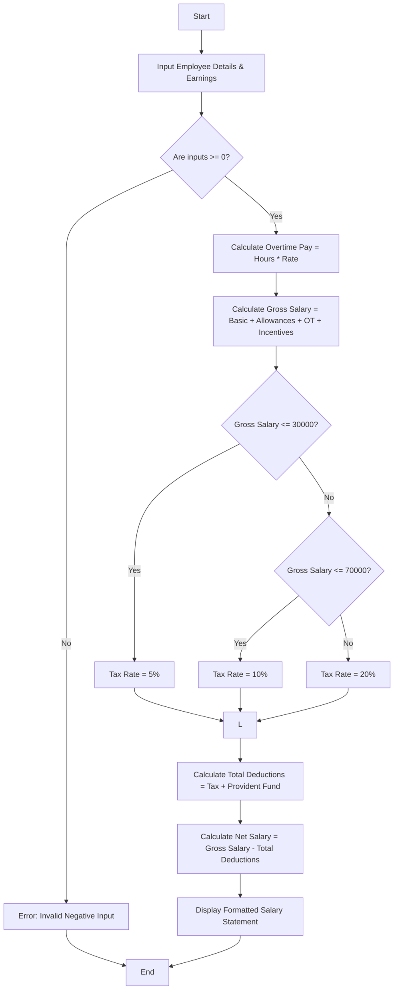

Here is a complete package for the **Employee Payroll and Deduction Analysis** system, featuring the problem statement, algorithm, Mermaid flowchart, Python source code, sample inputs, and sample outputs.

---

## 1. Problem Statement

Design an automated payroll and deduction analysis system for an organization. The system must compute total earnings by aggregating **basic pay**, **allowances**, **overtime earnings**, and **performance incentives** to find the **Gross Salary**. Following this, it must apply **progressive income tax deductions** based on salary brackets alongside a fixed provident fund (PF) contribution, and finally compute and print a formatted **Net Salary statement**.

---

## 2. Algorithm

1. **Start** and input employee details (ID, Name, Basic Pay, Allowances, Overtime Hours, Overtime Rate, Incentives).
2. **Validate Inputs:** Ensure all numerical figures (pay, hours, rates) are non-negative. If invalid, terminate with an error.
3. **Calculate Overtime Pay:** $\text{Overtime Pay} = \text{Overtime Hours} \times \text{Overtime Rate}$
4. **Calculate Gross Salary:** $\text{Gross Salary} = \text{Basic Pay} + \text{Allowances} + \text{Overtime Pay} + \text{Incentives}$
5. **Determine Progressive Tax Deduction:**
* If $\text{Gross Salary} \le 30,000$, Tax Rate = 5%
* Else if $\text{Gross Salary} \le 70,000$, Tax Rate = 10%
* Else, Tax Rate = 20%


6. **Calculate Statutory Deductions:**
* $\text{Income Tax} = \text{Gross Salary} \times \text{Tax Rate}$
* $\text{Provident Fund (PF)} = \text{Basic Pay} \times 12\%$
* $\text{Total Deductions} = \text{Income Tax} + \text{Provident Fund}$


7. **Calculate Net Salary:** $\text{Net Salary} = \text{Gross Salary} - \text{Total Deductions}$
8. **Display** the formatted salary statement.
9. **End**

---

## 3. Flowchart (Mermaid Code)



---

## 4. Python Source Code

```python
def calculate_payroll(emp_id, name, basic, allowances, ot_hours, ot_rate, incentives):
    # 1. Validate inputs
    if basic < 0 or allowances < 0 or ot_hours < 0 or ot_rate < 0 or incentives < 0:
        return {"Error": "Inputs cannot be negative."}
    
    # 2. Calculate Earnings
    ot_pay = ot_hours * ot_rate
    gross_salary = basic + allowances + ot_pay + incentives
    
    # 3. Progressive Tax Bracket Evaluation
    if gross_salary <= 30000:
        tax_rate = 0.05
    elif gross_salary <= 70000:
        tax_rate = 0.10
    else:
        tax_rate = 0.20
        
    income_tax = gross_salary * tax_rate
    provident_fund = basic * 0.12  # Standard 12% PF on basic pay
    total_deductions = income_tax + provident_fund
    
    # 4. Calculate Net Salary
    net_salary = gross_salary - total_deductions
    
    # 5. Return structured statement
    return {
        "Employee ID": emp_id,
        "Employee Name": name,
        "Basic Pay": basic,
        "Allowances": allowances,
        "Overtime Pay": ot_pay,
        "Incentives": incentives,
        "Gross Salary": gross_salary,
        "Income Tax": income_tax,
        "Provident Fund (PF)": provident_fund,
        "Total Deductions": total_deductions,
        "Net Salary": net_salary
    }

# --- Execution Example ---
if __name__ == "__main__":
    statement = calculate_payroll(
        emp_id="EMP1024",
        name="Alex Smith",
        basic=45000.0,
        allowances=8000.0,
        ot_hours=10,
        ot_rate=250.0,
        incentives=5000.0
    )
    
    print("========================================")
    print("        EMPLOYEE SALARY STATEMENT       ")
    print("========================================")
    for key, value in statement.items():
        if isinstance(value, float):
            print(f"{key:25}: ${value:,.2f}")
        else:
            print(f"{key:25}: {value}")
    print("========================================")

```

---

## 5. Sample Input

```python
emp_id = "EMP1024"
name = "Alex Smith"
basic = 45000.0
allowances = 8000.0
ot_hours = 10
ot_rate = 250.0
incentives = 5000.0

```

---

## 6. Sample Output

```text
========================================
        EMPLOYEE SALARY STATEMENT       
========================================
Employee ID              : EMP1024
Employee Name            : Alex Smith
Basic Pay                : $45,000.00
Allowances               : $8,000.00
Overtime Pay             : $2,500.00
Incentives               : $5,000.00
Gross Salary             : $60,500.00
Income Tax               : $6,050.00
Provident Fund (PF)      : $5,400.00
Total Deductions         : $11,450.00
Net Salary               : $49,050.00
========================================

```
