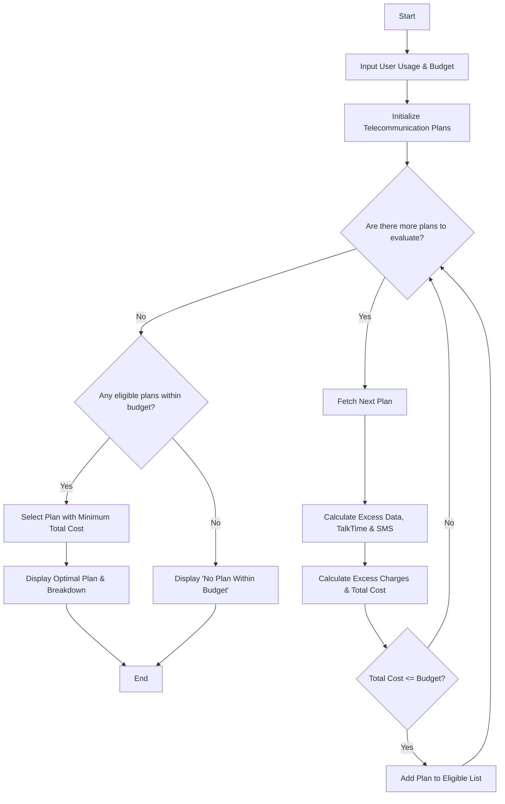

Here is a complete package for the **Multi-Plan Telecommunications Cost Optimization** system, including the problem statement, algorithm, Mermaid flowchart, Python source code, sample inputs, and sample outputs.

---

## 1. Problem Statement

Design an automated telecommunications optimization system that evaluates multiple mobile plans against a user's specific monthly usage (data, talk time, and SMS) and budget constraints. The system must compute any applicable excess charges when usage exceeds a plan's limits, filter out plans that exceed the user's budget, and identify the most economical eligible plan.

---

## 2. Algorithm

1. **Start** and input user usage profile (Data used in GB, Talk time minutes used, SMS count) and maximum budget.
2. **Initialize** a database of available mobile plans containing base prices, included limits (Data, TalkTime, SMS), and excess usage rates per unit.
3. **Loop through each plan:**
* Calculate **Excess Data** = $\max(0, \text{User Data} - \text{Plan Data Limit})$
* Calculate **Excess TalkTime** = $\max(0, \text{User TalkTime} - \text{Plan TalkTime Limit})$
* Calculate **Excess SMS** = $\max(0, \text{User SMS} - \text{Plan SMS Limit})$
* Calculate **Excess Charges** = $(\text{Excess Data} \times \text{Rate}) + (\text{Excess TalkTime} \times \text{Rate}) + (\text{Excess SMS} \times \text{Rate})$
* Calculate **Total Plan Cost** = $\text{Base Price} + \text{Excess Charges}$
* Check if $\text{Total Plan Cost} \le \text{Budget}$. If yes, add to the list of **Eligible Plans**.


4. **Evaluate Eligible Plans:**
* If eligible plans exist, select the one with the **minimum Total Plan Cost**.
* If no plans meet the budget constraint, notify the user.


5. **Display** the optimal plan, cost breakdown, and total expenditure.
6. **End**

---

## 3. Flowchart (Mermaid Code)



---

## 4. Python Source Code

```python
def optimize_telecom_plan(user_usage, budget, plans):
    eligible_plans = []
    
    for plan in plans:
        # 1. Calculate excess usage
        excess_data = max(0.0, user_usage["data_gb"] - plan["data_limit_gb"])
        excess_talk = max(0, user_usage["talk_mins"] - plan["talk_limit_mins"])
        excess_sms = max(0, user_usage["sms_count"] - plan["sms_limit"])
        
        # 2. Calculate excess charges
        excess_cost = (
            (excess_data * plan["excess_data_rate"]) +
            (excess_talk * plan["excess_talk_rate"]) +
            (excess_sms * plan["excess_sms_rate"])
        )
        
        total_cost = plan["base_price"] + excess_cost
        
        # 3. Check budget constraint
        if total_cost <= budget:
            eligible_plans.append({
                "plan_name": plan["name"],
                "base_price": plan["base_price"],
                "excess_cost": excess_cost,
                "total_cost": total_cost,
                "breakdown": {
                    "excess_data": excess_data,
                    "excess_talk": excess_talk,
                    "excess_sms": excess_sms
                }
            })
            
    if not eligible_plans:
        return {"Error": "No plans found within the specified budget."}
        
    # 4. Find the most economical eligible plan (minimum total cost)
    best_plan = min(eligible_plans, key=lambda x: x["total_cost"])
    return best_plan

# --- Execution Example ---
if __name__ == "__main__":
    # User Profile
    user_usage = {
        "data_gb": 15.0,    # 15 GB used
        "talk_mins": 350,   # 350 minutes used
        "sms_count": 50     # 50 SMS sent
    }
    monthly_budget = 60.00
    
    # Available Plans Catalogue
    telecom_catalogue = [
        {
            "name": "Saver Plan",
            "base_price": 30.00,
            "data_limit_gb": 10.0,
            "talk_limit_mins": 200,
            "sms_limit": 100,
            "excess_data_rate": 5.00,  # per GB
            "excess_talk_rate": 0.10,  # per min
            "excess_sms_rate": 0.05    # per SMS
        },
        {
            "name": "Standard Value Plan",
            "base_price": 45.00,
            "data_limit_gb": 20.0,
            "talk_limit_mins": 500,
            "sms_limit": 200,
            "excess_data_rate": 4.00,
            "excess_talk_rate": 0.08,
            "excess_sms_rate": 0.04
        },
        {
            "name": "Unlimited Pro Plan",
            "base_price": 75.00,
            "data_limit_gb": 50.0,
            "talk_limit_mins": 1000,
            "sms_limit": 500,
            "excess_data_rate": 2.00,
            "excess_talk_rate": 0.05,
            "excess_sms_rate": 0.02
        }
    ]
    
    result = optimize_telecom_plan(user_usage, monthly_budget, telecom_catalogue)
    
    print("========================================")
    print("     OPTIMIZED TELECOM PLAN RESULT      ")
    print("========================================")
    if "Error" in result:
        print(result["Error"])
    else:
        print(f"Selected Plan   : {result['plan_name']}")
        print(f"Base Price      : ${result['base_price']:.2f}")
        print(f"Excess Charges  : ${result['excess_cost']:.2f}")
        print(f"Total Cost      : ${result['total_cost']:.2f}")
        print("Excess Usage Details:")
        print(f" - Extra Data   : {result['breakdown']['excess_data']} GB")
        print(f" - Extra Talk   : {result['breakdown']['excess_talk']} mins")
        print(f" - Extra SMS    : {result['breakdown']['excess_sms']} count")
    print("========================================")

```

---

## 5. Sample Input

```python
user_usage = {
    "data_gb": 15.0,
    "talk_mins": 350,
    "sms_count": 50
}
budget = 60.00

```

---

## 6. Sample Output

```text
========================================
     OPTIMIZED TELECOM PLAN RESULT      
========================================
Selected Plan   : Standard Value Plan
Base Price      : $45.00
Excess Charges  : $0.00
Total Cost      : $45.00
Excess Usage Details:
 - Extra Data   : 0.0 GB
 - Extra Talk   : 0 mins
 - Extra SMS    : 0 count
========================================

```
