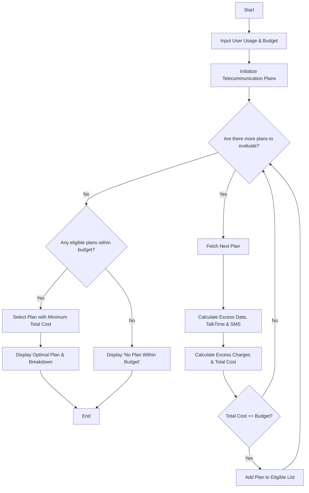

Here is a complete package for the **Multi-Plan Telecommunications Cost Optimization** system, including the problem statement, algorithm, Mermaid flowchart, Python source code, sample inputs, and sample outputs.

---

## 1. Problem Statement

Design an automated telecommunications optimization system that evaluates multiple mobile plans against a user's specific monthly usage (data, talk time, and SMS) and budget constraints. The system must compute any applicable excess charges when usage exceeds a plan's limits, filter out plans that exceed the user's budget, and identify the most economical eligible plan.

---

## 2. Algorithm

1. **Start** and input user usage profile (Data used in GB, Talk time minutes used, SMS count) and maximum budget.
2. **Initialize** a database of available mobile plans containing base prices, included limits (Data, TalkTime, SMS), and excess usage rates per unit.
3. **Loop through each plan:**
* Calculate **Excess Data** = $\max(0, \text{User Data} - \text{Plan Data Limit})$
* Calculate **Excess TalkTime** = $\max(0, \text{User TalkTime} - \text{Plan TalkTime Limit})$
* Calculate **Excess SMS** = $\max(0, \text{User SMS} - \text{Plan SMS Limit})$
* Calculate **Excess Charges** = $(\text{Excess Data} \times \text{Rate}) + (\text{Excess TalkTime} \times \text{Rate}) + (\text{Excess SMS} \times \text{Rate})$
* Calculate **Total Plan Cost** = $\text{Base Price} + \text{Excess Charges}$
* Check if $\text{Total Plan Cost} \le \text{Budget}$. If yes, add to the list of **Eligible Plans**.


4. **Evaluate Eligible Plans:**
* If eligible plans exist, select the one with the **minimum Total Plan Cost**.
* If no plans meet the budget constraint, notify the user.


5. **Display** the optimal plan, cost breakdown, and total expenditure.
6. **End**

---

## 3. Flowchart (Mermaid Code)



---


## 5. Sample Input

```python
user_usage = {
    "data_gb": 15.0,
    "talk_mins": 350,
    "sms_count": 50
}
budget = 60.00

```

---

## 6. Sample Output

```text
========================================
     OPTIMIZED TELECOM PLAN RESULT      
========================================
Selected Plan   : Standard Value Plan
Base Price      : $45.00
Excess Charges  : $0.00
Total Cost      : $45.00
Excess Usage Details:
 - Extra Data   : 0.0 GB
 - Extra Talk   : 0 mins
 - Extra SMS    : 0 count
========================================

```
