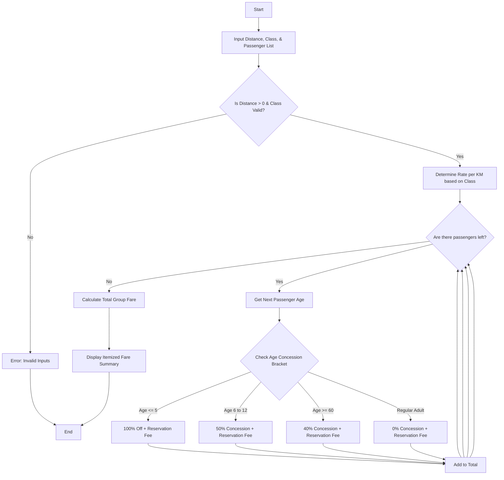

Here is a complete package for the **Railway Fare and Reservation Calculator** system, including the problem statement, algorithm, Mermaid flowchart, Python source code, sample inputs, and sample outputs.

---

## 1. Problem Statement

Design an automated railway ticketing and fare calculation system. The system must process journey details including **distance**, **travel class** (e.g., Sleeper, AC 3-Tier, AC 2-Tier), and a list of **passengers** with their ages. It must compute base fares according to distance slabs and class rates, apply **age-based concessions** (child and senior citizen discounts), add fixed **reservation fees**, and handle **cancellation penalties** if applicable, generating a detailed fare statement.

---

## 2. Algorithm

1. **Start** and input journey distance, travel class, and passenger list (Name, Age).
2. **Validate Inputs:** Check if distance is greater than 0 and if the selected class is valid.
3. **Determine Base Rate per KM** based on the travel class:
* Sleeper: $0.50 / km
* AC 3-Tier: $1.20 / km
* AC 2-Tier: $1.80 / km


4. **Iterate through each passenger:**
* Calculate $\text{Base Fare} = \text{Distance} \times \text{Class Rate}$
* Apply Concession:
* If Age $\le 5$: Free / 100% concession
* If Age between 6 and 12: 50% concession
* If Age $\ge 60$: 40% concession
* Otherwise: No concession (0%)


* Add fixed **Reservation Fee** (e.g., $15.00 per ticket).
* Accumulate individual fares into the **Total Group Fare**.


5. **Display** the itemized passenger ticket statement and total payable amount.
6. **End**

---

## 3. Flowchart (Mermaid Code)



---


## 5. Sample Input

```python
journey_distance = 650.0
selected_class = "AC 3-Tier"
passenger_list = [
    ("David Miller", 35),
    ("Sarah Miller", 32),
    ("Leo Miller", 9),
    ("Arthur Miller", 68)
]

```

---

## 6. Sample Output

```text
==================================================
          RAILWAY FARE STATEMENT SUMMARY          
==================================================
Journey Distance : 650.0 km
Travel Class     : AC 3-Tier
--------------------------------------------------
Passenger : David Miller (Age: 35 - Regular Adult)
  Base Fare       : $780.00
  Discount        : -$0.00
  Reservation Fee : $15.00
  Ticket Total    : $795.00
--------------------------------------------------
Passenger : Sarah Miller (Age: 32 - Regular Adult)
  Base Fare       : $780.00
  Discount        : -$0.00
  Reservation Fee : $15.00
  Ticket Total    : $795.00
--------------------------------------------------
Passenger : Leo Miller (Age: 9 - Child (50% Off))
  Base Fare       : $780.00
  Discount        : -$390.00
  Reservation Fee : $15.00
  Ticket Total    : $405.00
--------------------------------------------------
Passenger : Arthur Miller (Age: 68 - Senior Citizen (40% Off))
  Base Fare       : $780.00
  Discount        : -$312.00
  Reservation Fee : $15.00
  Ticket Total    : $483.00
--------------------------------------------------
TOTAL GROUP FARE  : $2478.00
==================================================

```
