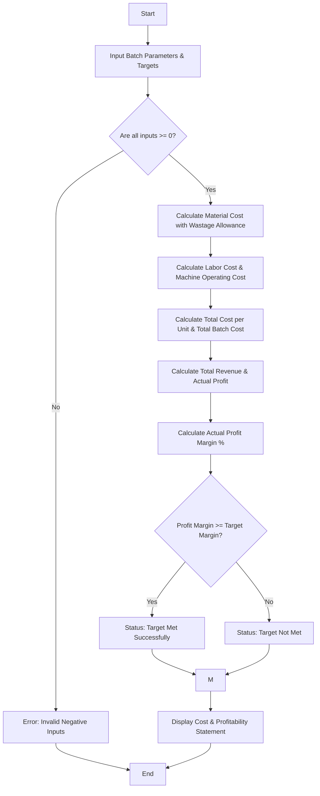

Here is a complete package for the **Manufacturing Cost and Profitability Analysis** system, including the problem statement, algorithm, Mermaid flowchart, Python source code, sample inputs, and sample outputs.

---

## ## 1. Problem Statement

Design an automated cost and profitability analysis system for a manufacturing enterprise. The system must process production batch parameters—including **raw material costs**, **direct labor charges**, **material wastage allowances**, and **machine operating expenses**—to compute the total cost of production. It must then compare the projected revenue against total costs to evaluate whether the batch meets a specified **profit target**.

---

## ## 2. Algorithm

1. **Start** and input production batch parameters: Units Produced, Raw Material Cost per unit, Labor Hours per unit, Labor Hourly Rate, Machine Hours per unit, Machine Hourly Rate, Material Wastage Percentage, Selling Price per unit, and Target Profit Margin percentage.
2. **Validate Inputs:** Ensure all numerical figures are non-negative. If invalid, terminate with an error.
3. **Calculate Adjusted Material Cost:**

$$\text{Material Cost per Unit} = (\text{Raw Material Unit Cost}) \times (1 + \text{Wastage Percentage})$$


4. **Calculate Direct Labor & Machine Costs:**

$$\text{Labor Cost per Unit} = \text{Labor Hours} \times \text{Labor Hourly Rate}$$


$$\text{Machine Cost per Unit} = \text{Machine Hours} \times \text{Machine Hourly Rate}$$


5. **Calculate Total Unit Cost & Total Batch Cost:**

$$\text{Total Cost per Unit} = \text{Material Cost} + \text{Labor Cost} + \text{Machine Cost}$$


$$\text{Total Batch Cost} = \text{Total Cost per Unit} \times \text{Units Produced}$$


6. **Calculate Revenue & Profitability:**

$$\text{Total Revenue} = \text{Selling Price per Unit} \times \text{Units Produced}$$


$$\text{Actual Profit} = \text{Total Revenue} - \text{Total Batch Cost}$$


$$\text{Profit Margin \%} = \left(\frac{\text{Actual Profit}}{\text{Total Revenue}}\right) \times 100$$


7. **Evaluate Target:** Check if $\text{Profit Margin \%} \ge \text{Target Profit Margin \%}$.
8. **Display** the comprehensive profitability analysis report.
9. **End**

---

## ## 3. Flowchart (Mermaid Code)



---

## ## 4. Python Source Code

```python
def analyze_manufacturing_profitability(
    units, material_cost, labor_hours, labor_rate, 
    machine_hours, machine_rate, wastage_pct, 
    selling_price, target_margin_pct
):
    # 1. Validate Inputs
    if units <= 0 or material_cost < 0 or labor_hours < 0 or labor_rate < 0 or \
       machine_hours < 0 or machine_rate < 0 or wastage_pct < 0 or selling_price < 0:
        return {"Error": "Invalid inputs: Costs, hours, and quantities cannot be negative."}

    # 2. Compute Costs per unit
    adjusted_material_cost = material_cost * (1 + (wastage_pct / 100.0))
    labor_cost = labor_hours * labor_rate
    machine_cost = machine_hours * machine_rate
    
    total_cost_per_unit = adjusted_material_cost + labor_cost + machine_cost
    total_batch_cost = total_cost_per_unit * units
    
    # 3. Compute Revenue & Profit
    total_revenue = selling_price * units
    actual_profit = total_revenue - total_batch_cost
    actual_margin_pct = (actual_profit / total_revenue * 100) if total_revenue > 0 else 0.0
    
    # 4. Target Evaluation
    target_met = actual_margin_pct >= target_margin_pct
    status = "Target Met Successfully" if target_met else "Target Not Met"

    # 5. Return Statement
    return {
        "Units Produced": units,
        "Adjusted Material Cost/Unit": adjusted_material_cost,
        "Labor Cost/Unit": labor_cost,
        "Machine Cost/Unit": machine_cost,
        "Total Cost per Unit": total_cost_per_unit,
        "Total Batch Cost": total_batch_cost,
        "Total Revenue": total_revenue,
        "Actual Profit": actual_profit,
        "Actual Margin (%)": actual_margin_pct,
        "Target Margin (%)": target_margin_pct,
        "Production Status": status
    }

# --- Execution Example ---
if __name__ == "__main__":
    result = analyze_manufacturing_profitability(
        units=1000,
        material_cost=25.00,
        labor_hours=2.0,
        labor_rate=15.00,
        machine_hours=1.5,
        machine_rate=40.00,
        wastage_pct=5.0,        # 5% material wastage
        selling_price=120.00,
        target_margin_pct=25.0  # 25% target profit margin
    )
    
    print("========================================")
    print("  MANUFACTURING PROFITABILITY ANALYSIS  ")
    print("========================================")
    for key, value in result.items():
        if isinstance(value, float):
            if "Margin" in key:
                print(f"{key:30}: {value:.2f}%")
            else:
                print(f"{key:30}: ${value:,.2f}")
        else:
            print(f"{key:30}: {value}")
    print("========================================")

```

---

## ## 5. Sample Input

```python
units = 1000
material_cost = 25.00
labor_hours = 2.0
labor_rate = 15.00
machine_hours = 1.5
machine_rate = 40.00
wastage_pct = 5.0
selling_price = 120.00
target_margin_pct = 25.0

```

---

## ## 6. Sample Output

```text
========================================
  MANUFACTURING PROFITABILITY ANALYSIS  
========================================
Units Produced                : 1000
Adjusted Material Cost/Unit   : $26.25
Labor Cost/Unit               : $30.00
Machine Cost/Unit             : $60.00
Total Cost per Unit           : $116.25
Total Batch Cost              : $116,250.00
Total Revenue                 : $120,000.00
Actual Profit                 : $3,750.00
Actual Margin (%)             : 3.12%
Target Margin (%)             : 25.00%
Production Status             : Target Not Met
========================================

```
