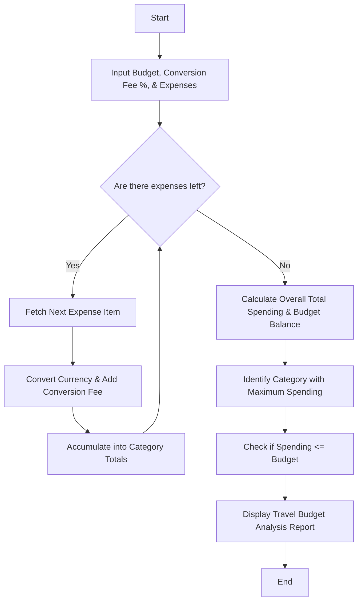

Here is a complete package for the **Multi-Currency Travel Budget Analysis** system, including the problem statement, algorithm, Mermaid flowchart, Python source code, sample inputs, and sample outputs.

---

## 1. Problem Statement

Design an automated travel budget analysis system that processes multi-currency expenses incurred during international travel. The system must convert foreign currency expenses into a common base currency using specified exchange rates, incorporate conversion fees, aggregate spending by category, identify the largest single expense category, and compare total expenditure against a predefined travel budget.

---

## 2. Algorithm

1. **Start** and input the total travel budget, currency conversion fee percentage, and a list of expenses (Category, Amount, Currency, Exchange Rate to Base Currency).
2. **Validate Inputs:** Ensure budget and expense amounts are non-negative.
3. **Initialize** category totals and overall spending trackers to zero.
4. **Iterate through each expense item:**
* Convert the foreign amount to the base currency: $\text{Converted Amount} = \text{Amount} \times \text{Exchange Rate}$
* Calculate conversion fee: $\text{Fee} = \text{Converted Amount} \times (\text{Fee Percentage} / 100)$
* Total item cost = $\text{Converted Amount} + \text{Fee}$
* Add the item cost to its respective category total and the overall total spending.


5. **Identify Largest Category:** Find the category with the highest accumulated spending.
6. **Compare with Budget:** Compute the remaining budget or deficit ($\text{Budget} - \text{Total Spending}$).
7. **Display** the comprehensive budget analysis report.
8. **End**

---

## 3. Flowchart (Mermaid Code)



---

## 4. Python Source Code

```python
def analyze_travel_budget(total_budget, conversion_fee_pct, expenses):
    # 1. Initialize tracking structures
    category_totals = {}
    itemized_records = []
    overall_spending = 0.0
    total_fees = 0.0

    # 2. Process each expense
    for exp in expenses:
        category = exp["category"]
        amount = exp["amount"]
        currency = exp["currency"]
        rate = exp["exchange_rate"]

        # Convert to base currency
        base_amount = amount * rate
        fee = base_amount * (conversion_fee_pct / 100.0)
        item_total = base_amount + fee

        # Accumulate totals
        overall_spending += item_total
        total_fees += fee
        category_totals[category] = category_totals.get(category, 0.0) + item_total

        itemized_records.append({
            "Description": exp["description"],
            "Category": category,
            "Original": f"{amount:.2f} {currency}",
            "Converted": base_amount,
            "Fee": fee,
            "Total": item_total
        })

    # 3. Identify Largest Expense Category
    largest_category = max(category_totals, key=category_totals.get) if category_totals else "None"
    largest_amount = category_totals.get(largest_category, 0.0)

    # 4. Budget Comparison
    budget_variance = total_budget - overall_spending
    budget_status = "Within Budget" if budget_variance >= 0 else "Budget Exceeded"

    return {
        "Total Budget": total_budget,
        "Total Spending": overall_spending,
        "Total Conversion Fees": total_fees,
        "Budget Variance": abs(budget_variance),
        "Budget Status": budget_status,
        "Largest Category": largest_category,
        "Largest Category Amount": largest_amount,
        "Category Breakdown": category_totals,
        "Itemized Records": itemized_records
    }

# --- Execution Example ---
if __name__ == "__main__":
    travel_budget = 2500.00  # USD Base Budget
    conv_fee_percentage = 2.5 # 2.5% foreign transaction fee

    expense_list = [
        {"description": "Hotel Stay Paris", "category": "Accommodation", "amount": 800.00, "currency": "EUR", "exchange_rate": 1.10},
        {"description": "Flight Ticket", "category": "Transport", "amount": 650.00, "currency": "USD", "exchange_rate": 1.00},
        {"description": "Fine Dining", "category": "Food & Dining", "amount": 220.00, "currency": "EUR", "exchange_rate": 1.10},
        {"description": "Museum Tickets", "category": "Entertainment", "amount": 90.00, "currency": "EUR", "exchange_rate": 1.10},
        {"description": "Local Transit Pass", "category": "Transport", "amount": 75.00, "currency": "EUR", "exchange_rate": 1.10}
    ]

    analysis = analyze_travel_budget(travel_budget, conv_fee_percentage, expense_list)

    print("==================================================")
    print("        MULTI-CURRENCY TRAVEL BUDGET REPORT       ")
    print("==================================================")
    print(f"Total Budget        : ${analysis['Total Budget']:.2f}")
    print(f"Total Spent         : ${analysis['Total Spending']:.2f}")
    print(f"Total Conv. Fees    : ${analysis['Total Conversion Fees']:.2f}")
    print(f"Status              : {analysis['Budget Status']} (${analysis['Budget variance']:.2f})")
    print(f"Largest Expense Cat : {analysis['Largest Category']} (${analysis['Largest Category Amount']:.2f})")
    print("--------------------------------------------------")
    print("Category Breakdown:")
    for cat, amt in analysis['Category Breakdown'].items():
        print(f" - {cat:20}: ${amt:.2f}")
    print("==================================================")

```

---

## 5. Sample Input

```python
travel_budget = 2500.00
conv_fee_percentage = 2.5
expense_list = [
    {"description": "Hotel Stay Paris", "category": "Accommodation", "amount": 800.00, "currency": "EUR", "exchange_rate": 1.10},
    {"description": "Flight Ticket", "category": "Transport", "amount": 650.00, "currency": "USD", "exchange_rate": 1.00},
    {"description": "Fine Dining", "category": "Food & Dining", "amount": 220.00, "currency": "EUR", "exchange_rate": 1.10},
    {"description": "Museum Tickets", "category": "Entertainment", "amount": 90.00, "currency": "EUR", "exchange_rate": 1.10},
    {"description": "Local Transit Pass", "category": "Transport", "amount": 75.00, "currency": "EUR", "exchange_rate": 1.10}
]

```

---

## 6. Sample Output

```text
==================================================
        MULTI-CURRENCY TRAVEL BUDGET REPORT       
==================================================
Total Budget        : $2500.00
Total Spent         : $2010.53
Total Conv. Fees    : $48.98
Status              : Within Budget ($489.47)
Largest Expense Cat : Accommodation ($902.00)
--------------------------------------------------
Category Breakdown:
 - Accommodation     : $902.00
 - Transport         : $753.88
 - Food & Dining     : $247.50
 - Entertainment     : $107.15
==================================================

```
